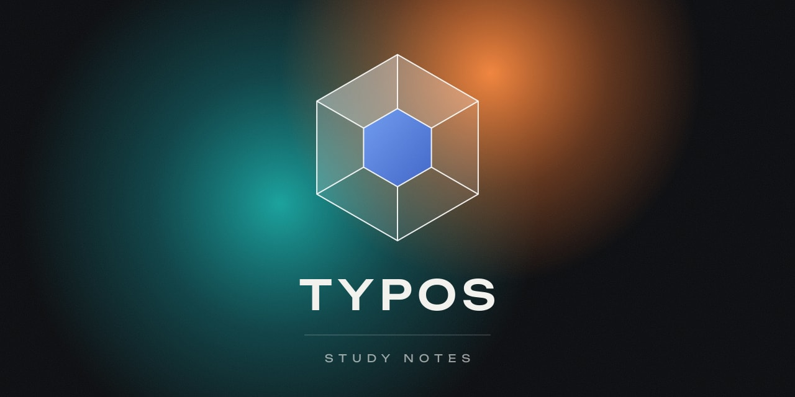
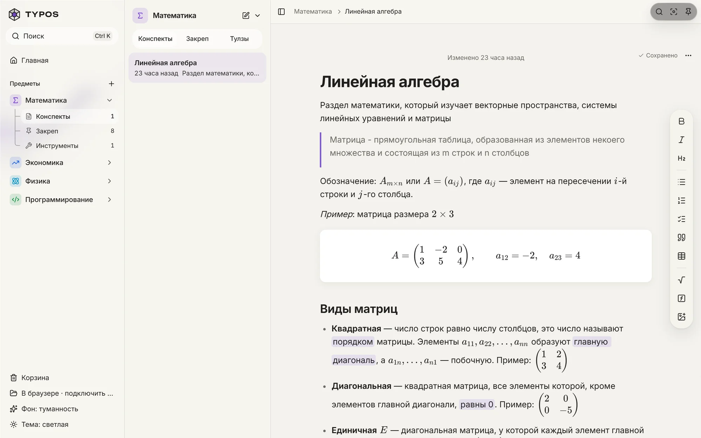
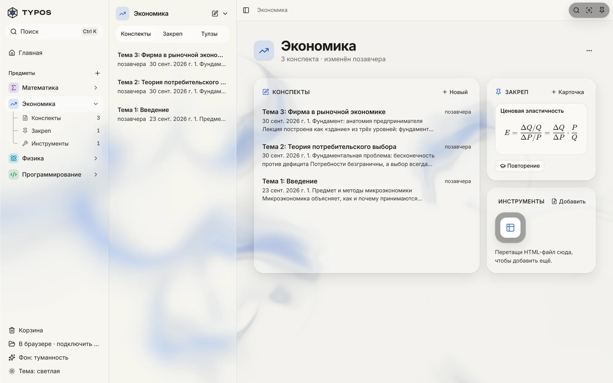
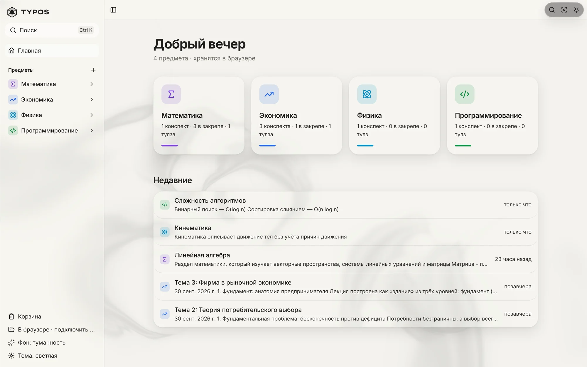

<p align="center">
  
</p>

<p align="center">
  <b>Study notes with real math, one folder per subject.</b><br>
  A notes app for Windows modeled on Apple Notes. It works offline and keeps everything as Markdown files on your disk.
</p>

<p align="center">
  <a href="#quick-start"><b>Quick start</b></a> ·
  <a href="#features">Features</a> ·
  <a href="#how-it-works">How it works</a> ·
  <a href="#roadmap">Roadmap</a>
</p>

<p align="center">
  
  
  
  
  
  
  
</p>

<picture>
  <source media="(prefers-color-scheme: dark)" srcset="docs/screenshots/note-dark.webp">
  
</picture>

<p align="center"><sub>The interface is in Russian.</sub></p>

## Why I made it

I couldn't find a notes app on Windows that I liked for studying. Notion is slow and needs a VPN where I live, and Apple Notes only runs on Apple devices.

In TYPOS a subject is a folder. Open it and the lecture notes are right there, next to the formula cards I revise from and the calculators I made for that subject. Formulas look like they do in a textbook, and the files stay on my computer.

## Features

- Markdown editor with KaTeX math. Write `$…$` inline and `$$…$$` for a block. Matrices, determinants and systems of equations render as you type.
- Formulas copied from websites and documents paste as formulas you can edit.
- Tables, text color and highlight, a toolbar over selected text, and a visual formula editor for when you don't remember the LaTeX.
- Formula cards for the key formulas of each subject, with a review mode for exam prep.
- Small HTML tools such as calculators and trainers live inside a subject. They run in a sandboxed iframe with no access to your notes.
- `Ctrl K` searches every subject. It ignores case and treats е and ё as the same letter.
- Deleted items stay in the trash for 30 days, and every delete can be undone.
- If a note's file changes on disk while the note is open, TYPOS loads the new version. If you have unsaved edits, it asks which version to keep.
- The interface is frosted glass over an animated background, in a light or dark theme. Inside a subject the accent color matches the subject's icon.

<picture>
  <source media="(prefers-color-scheme: dark)" srcset="docs/screenshots/subject-dark.webp">
  
</picture>

<details>
<summary>Home screen</summary>
<br>

</details>

## Quick start

You need Node.js 22 or newer, and Chrome or Edge. Those two browsers can read and write a folder on your disk.

```bash
git clone https://github.com/robloxlover44/typos.git
cd typos
npm install
npm run dev
```

Open <http://localhost:5173> and pick a folder for your notes. You can also start without one. Notes are then kept in the browser, and one button moves them to a folder later.

The desktop app works in any OS window, without Chrome or Edge. It needs [Rust and the Tauri prerequisites](https://v2.tauri.app/start/prerequisites/); then run `npm run desktop`.

| Command | What it does |
| --- | --- |
| `npm run dev` | Starts the app locally |
| `npm run build` | Type-checks and builds for production |
| `npm test` | Runs the tests with Vitest |
| `npm run check` | Type-checks, lints, checks formatting and runs the tests: run it before every commit |
| `npm run format` | Formats the code with Prettier |
| `npm run icons` | Regenerates the icons and the logo from one shared geometry |
| `npm run storage -- --dir <folder>` | Starts a storage server for that folder |
| `npm run desktop` | Starts the desktop app (Tauri) with hot reload |
| `npm run desktop:build` | Builds the desktop installers |
| `npm run test:rust` | Runs the tests of the desktop backend |
| `npm run mcp -- --vault <folder>` | Starts the MCP server for AI assistants (or `--link typos://…` for a storage server) |

## How it works

Your notes are a normal folder. There is no database, only Markdown, JSON and images. The files open in Obsidian or VS Code and sync with whatever you already use.

```
Study/
├── .studynotes/trash/          deleted items, kept for 30 days
└── Math/                       one folder per subject
    ├── _subject.json           color, icon and order
    ├── Конспекты/              notes
    │   ├── Linear algebra.md
    │   └── assets/             images, saved as webp
    ├── Закреп/                 formula cards
    │   └── Cramer's rule.md
    └── Инструменты/            HTML tools
        └── Inverse matrix.html
```

The three folder names inside a subject are fixed: `Конспекты` for notes, `Закреп` for formula cards and `Инструменты` for tools.

A note is Markdown with a short frontmatter block. Its first line is the title, and the file is named after it.

```markdown
---
id: xu66wudd
created: 2026-10-12T22:08:03.308Z
updated: 2026-10-13T20:14:32.046Z
---

# Linear algebra

A 2×2 determinant: $\det A = ad - bc$
```

| Layer | Tech |
| --- | --- |
| Interface | React 19, TypeScript, Tailwind CSS 4, shadcn/ui, Motion |
| Editor | Tiptap 3, KaTeX, MathLive |
| Storage and search | File System Access API, IndexedDB, MiniSearch |
| Desktop | Tauri 2, Rust |
| Storage server | Node.js, no dependencies, a subset of WebDAV |
| Background | three.js with a WebGL shader |
| Build | Vite 8, vite-plugin-pwa, Vitest, Prettier, oxlint |

```
src/
├── app/        app shell, routes, theme and subject colors
├── editor/     editor, math, paste handling and Markdown
├── features/   formula cards, tools, search, subjects
├── storage/    disk folder, browser storage, storage server and sync
└── vault/      file format and operations on the notes folder
server/         storage server (one file) and its tests
src-tauri/      desktop app: window and file access in Rust
mcp/            MCP server for AI assistants (folder or storage server)
```

## Storage server

To keep notes on another machine (a home server, a NAS, a VPS) run the storage server there. It is one file with no dependencies and needs Node.js 18 or newer (20 or newer to see edits made directly in the folder on the server right away). There are no accounts: access is a key inside the connection link.

```bash
node server/typos-server.mjs --dir ./vault
```

Every start prints the same connection link, one per address, labelled by where TYPOS is opened: `localhost` when the app runs on the same computer, the network address when it runs on another device. In TYPOS open the storage screen, paste the link and press «Подключить». The link contains the key, so treat it like a password. When the server runs without a terminal (systemd, Docker) the link is not printed; get it with `link`.

One link works for all your devices, and they all see the same vault. Separate device keys are optional and only let you disconnect one device without touching the others.

| Command | What it does |
| --- | --- |
| `link [device] --dir ./vault` | Prints the link again. With a new device name, creates a separate key for it |
| `rotate <device> --dir ./vault` | Gives a device a new key. Its old link stops working (`rotate default` for the shared link) |
| `devices --dir ./vault` | Lists devices and when they were last seen |
| `revoke <device> --dir ./vault` | Disconnects a device. The server picks this up without a restart |

Each device keeps its own copy of the server vault. Edits are saved to that copy first and sent to the server right away. When the server can't be reached, you keep working: the edits wait on the device and go up as soon as it is back, and the sidebar shows how many are still waiting. Changes from other devices arrive on their own. If the same file was changed on two devices while they were offline, both versions are kept, and the second one gets «(конфликт …)» in its name.

«Отключить» on the storage screen disconnects the app from the server. The notes stay on the server, and the app goes back to the browser storage exactly as it was before you connected. The device's copy of the server vault stays in the browser too, so edits that were still waiting go up when you connect again.

Bad keys are rate-limited: 10 wrong keys in a minute block that address for a minute. Behind a proxy on the same machine with `--public-url`, the address is taken from the proxy's `X-Forwarded-For` header, so one client can't lock out the others.

The app can run on `localhost` or on any address in your network, for example `npm run preview -- --host`. If the app is opened over `https://`, the server needs HTTPS too: pass `--cert` and `--key`, or put it behind a proxy such as Caddy and pass `--public-url https://notes.example.com`. Over plain `http://` on a network address the browser turns off the folder picker and offline install, but the storage server still works.

The server keeps the vault as the same plain files and speaks a subset of WebDAV under `/files/`, so you can also mount it in a file manager (any user name, the key as the password). Keys are stored in `.typos-server/` inside the vault, readable only by the server's user. The server never serves that folder, under any spelling of its name or through a link.

## MCP server

The MCP server lets an AI assistant such as Claude read your notes and write new ones: notes, formula cards and tools, in the same format the app writes. It works with a folder on this computer or with a storage server.

```bash
# a notes folder on this computer
npx tsx --tsconfig mcp/tsconfig.json mcp/server.ts --vault "/path/to/notes"
# a storage server: get a link for it with `link mcp` on the server
npx tsx --tsconfig mcp/tsconfig.json mcp/server.ts --link "typos://…"
```

Instead of the flags you can set `STUDYNOTES_VAULT` or `STUDYNOTES_LINK`. With a link, every device sees the assistant's edits right away; with a folder, the app picks them up when its window gets focus. A separate device key (`link mcp`) lets you disconnect the assistant without touching your other devices. If the storage server is off when the assistant starts, the MCP server still starts and its tools report that the server can't be reached until it is back.

For a remote MCP endpoint on Railway with OAuth, see [Remote MCP on Railway](docs/mcp-railway.md). The local stdio mode remains available.

For a desktop plugin with a local marketplace entry and private per-user storage settings, see [the TYPOS plugin](plugins/typos/README.md).

## Roadmap

- [x] Desktop build with Tauri
- [x] Sync between devices through a storage server
- [ ] Phone app
- [ ] Spaced repetition for formula cards
- [ ] PDF course materials next to the notes

<br>

<p align="center">
  <br>
  <sub>TYPOS is a personal project, released under the <a href="LICENSE">MIT License</a>.</sub>
</p>
